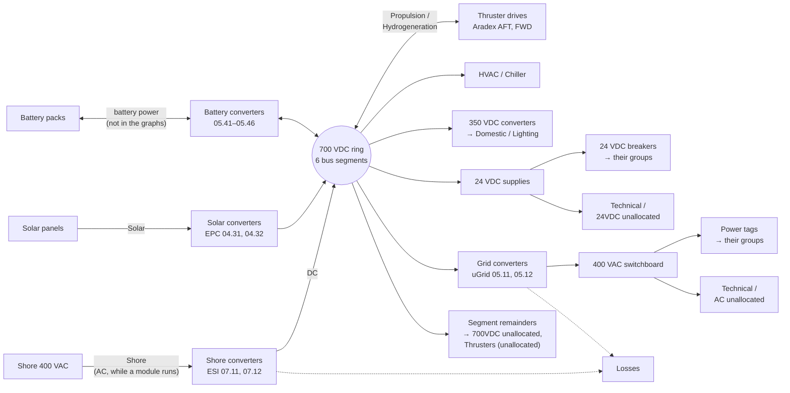

# Energy dashboards: how the model works

This page describes how the electrical and historical energy dashboards count energy: where each number
comes from, how producers, consumers and losses are counted, and what the model can't see yet. It describes
the model as built on 25 Nov 2026. Update it when the model or the IO changes.

## The picture



## Groups

Every series on the dashboards belongs to a **main group** and a **sub group**.

- **Producers:** Shore, Solar, Hydrogeneration.
- **Consumers:** Domestic, HVAC, Technical, Propulsion, and Losses. Losses is a consumer group, so it shows
  up in every consumer panel, the treemaps included.
- **Batteries** are neither. The production and consumption graphs leave them out, so the gap between
  production and consumption is what the batteries charge or discharge, plus the measurement error. The flow
  diagram shows them separately.

A sub group holds more than one consumer, unless that consumer is large on its own (the chiller). Load that
no signal covers goes into one *unallocated* sub group per main group.

## How each number is made

All views give power per minute, in W. A panel adds up the minutes and divides by 60 to get energy in Wh.

| Series | Main group / sub group | How it is made | View |
|---|---|---|---|
| Shore | Shore / Shore power converter PS, SB | AC power each ESI module draws from shore, counted only while the module runs | `gld_shore_power_per_minute_per_*` |
| Solar | Solar / Owners bimini, Main bimini | Power each EPC converter delivers to the bus; drawing from the bus counts as 0 | `gld_solar_power_per_minute_per_*` |
| Thrusters | Propulsion / Thrusters, Hydrogeneration / Thrusters | Aradex power, split by sign: positive is propulsion, negative is hydrogeneration | `gld_aradex_power_per_minute_per_group` |
| Power tags | Per tag, from `power_tag_metadata` | AC consumers with a power tag. The 10P1 and 10P2 feeders are excluded: their consumers have their own tags | `gld_power_tags_power_per_minute_per_*` |
| AC unallocated | Technical / AC unallocated | Grid converters' AC output minus the power tag total | `gld_grid_converter_power_per_minute_per_group` |
| 24 VDC breakers | Per breaker, from `dc_24v_metadata` | Breaker current × converter voltage | `gld_24vdc_power_per_minute_per_*` |
| 24VDC unallocated | Technical / 24VDC unallocated | 24 VDC supplies' output minus the breaker total | `gld_24vdc_unallocated_power_per_minute_per_group` |
| 350 VDC | Domestic / Lighting | Sum of the four 350 VDC converters on their 700 VDC side | `gld_350vdc_power_per_minute_per_group` |
| Chiller | HVAC / Chiller | Its two compressors and its seawater pump | `gld_chiller_power_per_minute_per_group` |
| Segment remainders | Technical / 700VDC unallocated, Propulsion / Thrusters (unallocated) | Per bus segment of the 700 VDC ring (see below) | `gld_dc_ring_unallocated_power_per_minute_per_group` |
| Shore converter losses | Losses / Shore converters | AC − DC per ESI module, while it runs | `gld_shore_converter_losses_per_minute_per_group` |
| Grid converter losses | Losses / Grid converters | DC input − AC output per uGrid | `gld_grid_converter_power_per_minute_per_group` |

### The 700 VDC ring

Most 700 VDC consumers have no power signal: winches, power packs, pumps, water heaters. The ring makes them
visible per bus segment anyway. The ring has 8 DC switches (05.71–05.78) that measure current and voltage,
and 8 segments between them:

```text
05.71 | SB.01.P01 | 05.72 | SB.01.P02 | 05.73 | SB.01.P03 | 05.74 | SB.01.P04 | 05.75 | cable |
05.76 | SB.02.P01 | 05.77 | SB.02.P02 | 05.78 | cable | back to 05.71
```

For each segment and minute:

1. **Load** = power that flows in through its two switches − power that flows out.
2. **Measured** = the sources on the segment that have a power signal: shore and battery converters, grid
   converters, 350 VDC converters, 24 VDC supplies, thruster drives, chiller. A source that feeds the bus
   counts negative.
3. **Remainder** = load − measured: the consumers on that segment without a signal.

The remainders of SB.01.P01 and SB.01.P04 (the stern drive's segments) are *Propulsion / Thrusters
(unallocated)*. The other four are *Technical / 700VDC unallocated*. The two cable segments have nothing
connected, so their remainder is the measurement error of the switches. It stays off the dashboards.

All of this is set in metadata tables (`zero-data/dbt/macros/load_dc_ring_metadata.sql`):

- the sign of each switch, fitted from the data, because the drawings don't say which side is which;
- the segment of each source;
- the group of each segment's remainder.

Added over all segments, the switch flows cancel out. The total remainder is therefore the gap between what
the measured sources feed in and take out, whatever the switches read. The switches only decide which
segment it shows on. On 18 Nov 08:00–14:00, shore equalled consumers + losses + battery charging + cable
offset to within 0.02 kWh.

## Where the groups are set

| What | Where |
|---|---|
| Main group and sub group of each power tag, and which tags are excluded | `zero-data/dbt/macros/load_power_tag_metadata.sql` |
| Converter, main group and sub group of each 24 VDC breaker | `zero-data/dbt/macros/load_24vdc_metadata.sql` |
| DC switch signs, segment of each source, group of each segment | `zero-data/dbt/macros/load_dc_ring_metadata.sql` |
| Fixed groups (shore, solar, thrusters, chiller, 350 VDC, losses, unallocated) | The gold view itself |

## Caveats

### Missing samples count as zero (no forward-fill)

A view averages the samples within each minute. A minute without a sample has no row, and the panels add up
the minutes, so that minute counts as 0 W. Many signals are published only when their value changes. A steady
load then publishes nothing and is counted too low, or not at all. Within a minute, the average weighs each
sample the same, not by how long its value held.

The fix is to forward-fill these signals: carry the last value forward until the next sample, up to a limit
so a source that has stopped doesn't keep its last value for ever. First we need to know which signals
publish only on change. See ZERO-2748.

The *unallocated* series make this worse: when the breakers or power tags have no data in a minute, all of
the 24 VDC or AC output counts as unallocated.

### Known errors and assumptions

- **Remainders are measurements, not consumers.** A remainder holds every unmeasured consumer on its
  segment, plus the switches' measurement error (about ±1 kW per segment) and the losses of the battery and
  24 VDC converters (measured on their output side). A minute can go below zero; it is kept as measured, so
  the energy adds up.
- **No segment remainders before 20 Oct 2026.** Before then the switch currents read about −1000 A; those
  samples are left out. A minute counts only when all 8 switches report.
- **Aradex power before 10 Nov 2026 is about 12 times too high**, so on older days with thruster use the
  remainders of SB.01.P01 and P04 go far below zero.
- **Shore converter offset:** an idle ESI module reads a DC current (07-12-tbc1a +1.8 A, about +1.2 kW).
  A module counts only while it runs, but the offset likely stays while it runs: 07-12-tbc1a's losses then
  read about 1.2 kW too low. Marpower is asked to check (ZERO-2737).
- **350 VDC consumers can't be split.** The 350 VDC output measurements (DcOpp) read 0, so the whole 350 VDC
  network is *Domestic / Lighting*, its converter losses included. The 350 VDC network is tied between aft and
  fwd, and power flows in at one converter and out at another (up to about 2 kW). Only the sum is the load.
- **Battery packs charge each other** in about 9 % of the minutes, about 15 kW. The flow diagram adds the
  charging and the discharging packs up separately, so in those minutes it shows both sides too high.
- **24 VDC supply placement is assumed.** Their load is too steady to fit to a segment. From the drawings,
  group _01 is on the aft feed and _02 on the fwd feed.
- **Solar converters aren't connected yet**, so Solar reads 0.
- **Battery converters 05.45 and 05.46 are offline.** Their segments are taken from the functional
  description.
- **Load per segment and the cable offset** aren't on the energy dashboards. They are planned for the Load
  balance dashboard (ZERO-2736).
- **Stale data:** the electrical energy dashboard shows a *Stale data* link when a source has had no sample
  for 15 minutes.

## More IO would split the unallocated groups

These consumers have no power signal, so they end up in an unallocated group. With their own signal, each
would get a real sub group and the unallocated groups would shrink. Typical size, 16–24 Nov 2026:
700VDC unallocated about 3.3 kW, Thrusters (unallocated) about 1.2 kW, AC unallocated about 4 kW, 24VDC
unallocated about 1.8 kW.

| Consumer | Now in | Segment | What would help | Sub group with the signal |
|---|---|---|---|---|
| Compression chiller =30.11 | 700VDC unallocated while its feed is down | SB.01.P02 | Its Termodinamica feed (`termodinamica__ac_misc`) had data only Jun–early Jul and stopped on 30 Oct. Restart it | HVAC / Chiller |
| Power packs 1 and 2 =22.61, =22.62 | 700VDC unallocated | SB.01.P02, SB.02.P01 | Power from the sail-hydraulic PLC or the drives | Propulsion / Sail handling |
| Winches, feeders and furlers on DB-HDC02–06 (about 40) | 700VDC unallocated | SB.01.P02–SB.02.P02 | Power per winch drive from the sail-hydraulic PLC supplier | Propulsion / Sail handling |
| Steering power pack =15.11 | 700VDC unallocated | SB.01.P03 | Power signal | Propulsion / Steering |
| Lube oil pumps =22.11, =22.12 | Thrusters (unallocated), 700VDC unallocated | SB.01.P01, SB.02.P01 | Power signal | Propulsion / Lube oil |
| General service pumps 1–3 =34.11–34.13 | 700VDC unallocated | SB.01.P02, SB.02.P01 | Pumps 1 and backup are in the IO list (KEB1, KEB2) but have no MQTT topic. Publish them | Technical / Bilge/FiFi |
| Domestic water heaters 1–18 =25.41 | 700VDC unallocated | SB.01.P03, SB.02.P02 | Power signal; then decide between Technical / Fresh water and Domestic / Hot water | To decide |
| Anchor winches, pop-up deck winches | 700VDC unallocated | SB.02.P02 | Power signal | Technical / Deck equipment |
| Thruster drive standby | Thrusters (unallocated) | SB.01.P01, P04 | Check whether the Aradex power covers it | Propulsion / Thrusters |
| 350 VDC outputs (DcOpp U101/U102/U104) | Domestic / Lighting | – | Marpower to fix the outputs that read 0 | Lighting split per output |
| Consumers behind 10P3 (washers, dryers, dishwasher, crew sockets, toilets) | Domestic / Crew & laundry (feeder) | AC | Power tags per consumer; `power-tags/10P3/washer-1` publishes no values | Domestic / Laundry, Crew; Technical / Black water |
| AC load without a power tag | Technical / AC unallocated | AC | Find which breakers have no tag or no metadata | Per breaker |
| 24 VDC load not behind a monitored breaker (PLCs, AMCS, network, KVM) | Technical / 24VDC unallocated | 24 VDC | Current per breaker | Per breaker |

**Don't add** the THRS pumps (`marpower__thrs__pumps`) and the technical-space fans
(`marpower__350000_ventilation`): they report power, but they are most likely behind breakers that already
have a power tag, so they would be counted twice. Use them only to split a sub group, after checking in
Eplan which breakers feed them.
