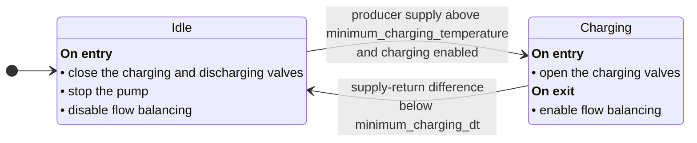

# Manual skeleton and diagram house style

## The manual

The manual is an **HTML fragment**: no `<html>`, `<head>` or `<style>`, just the
body content. The front-end renders it inside its Documentation tab with its own
styling, and `just manual_publish` prints it plainly in black and white with
`assets/print.css`, so the fragment carries structure only. Use only the elements
and classes below; anything else renders unstyled.

Fixed section order, so an engineer who has read one can navigate any of them.
Headings are literal; the `<!-- … -->` notes are guidance, not content to
reproduce.

```html
<h1><Module name> (<MODULE>)</h1>
<p class="lede"><!-- One sentence: what this module is for. A reader who stops
here should still know whether this is the document they want. --></p>

<h2>What it does</h2>
<p><!-- Three to five sentences. The physical job and what the module is trying
to maximise or protect — say so in the opening line, not halfway down. The
equipment it drives, the loop it runs each second, the measurements it acts on
and the setpoints it holds. Close with what happens when the heat, water or flow
it needs is not available: name the concrete fallback the operator will see. --></p>

<h2>Modes</h2>
<!-- The mode is what the panel shows as the current state of the control. One
dt per mode dimension, one badge per value. data-mode is the mimic's mode badge
name (see "Mode badges" below), so the manual shows the colour the mimic does.
Never say a mode is "derived" rather than coming from the state machine; the
operator sees one panel either way. -->
<dl class="modes">
  <dt>Filling</dt>
  <dd><span data-mode="Idle">idle</span><span data-mode="Filling">filling</span></dd>
  <dt>Boosting</dt>
  <dd>
    <span data-mode="Idle">idle</span>
    <span data-mode="Boosting">high-temperature boosting</span>
    <span data-mode="BoostingLow">heatpump boosting</span>
  </dd>
</dl>

<h2>Operating states</h2>
<figure class="diagram">
<pre class="mermaid">
stateDiagram-v2
  <!-- the module's machine, in the house style below -->
</pre>
<figcaption><!-- When it earns one — e.g. "Each of the three PVT groups runs
this machine independently." --></figcaption>
</figure>
<!-- A table only if it adds something the diagram cannot hold. If the figure
already carries the entry actions and conditions, do not restate them here —
that was the most common redundancy in the first drafts. Omit this whole section
for a module with no state machine; see below. -->

<h2 id="tuning">Tuning</h2>
<!-- The id is where the render script stops counting prose words; keep it.
One h3 and one table per group, every table with the same colgroup so the
columns line up; the front-end shows the header row only on the first. One row
per parameter, with its own default. The description goes in the first row of
an entry; parameters that share one (a functional group, the gains) put it in
a rowspan cell. -->
<h3>Charging</h3>
<table class="parameters">
  <colgroup><col class="name" /><col class="default" /><col /></colgroup>
  <thead>
    <tr><th>Parameter</th><th>Default</th><th>Meaning and tuning</th></tr>
  </thead>
  <tbody>
    <tr>
      <td><code>minimum_charging_temperature</code></td>
      <td>60 °C</td>
      <td><!-- What it means, then what you gain and give up by moving it. --></td>
    </tr>
    <tr>
      <td><code>pcm_charge_flow</code></td>
      <td>5 l/min</td>
      <td><!-- One clause: what fixes this value. --></td>
    </tr>
  </tbody>
</table>

<h3>Controller gains</h3>
<table class="parameters">
  <colgroup><col class="name" /><col class="default" /><col /></colgroup>
  <thead>
    <tr><th>Parameter</th><th>Default</th><th>Meaning and tuning</th></tr>
  </thead>
  <tbody>
    <tr>
      <td><code>pump_tuning</code></td>
      <td>0.01, 0.001, 0</td>
      <td rowspan="2">Proportional, integral and derivative gains for the PID
      controllers, tuned during commissioning.</td>
    </tr>
    <tr>
      <td><code>module1_flow_balance_tuning</code></td>
      <td>−0.005, −0.001, 0</td>
    </tr>
  </tbody>
</table>
<p class="constraints"><!-- Hard constraints from the validators, in plain
words. --></p>

<h2>Alarms</h2>
<table>
  <thead><tr><th>Alarm</th><th>Severity</th><th>Raised when</th></tr></thead>
  <tbody>
    <tr>
      <td>Tank 1 high temperature</td>
      <td><span data-severity="warning">warning</span></td>
      <td>…</td>
    </tr>
  </tbody>
</table>
```

Notes:

- **Defaults carry their unit** (`60 °C`, `5 l/min`, `0.3` for a ratio), exactly
  as the step-1 output prints them.
- **Parameter names always go in `<code>`**, in the prose as well as the tuning
  table: that is how the reader spots a label they can find on the panel.
- **PID defaults** are the three gains, comma-separated, with a real minus sign
  (`−0.01, −0.001, 0`).
- The controller gains group goes last.
- **Raised when** is the physical situation the predicate checks, in plain
  words, and nothing it does not check: "The tank in use is below
  `minimum_tank_temperature`", not the Python condition.
- **Severity** is `data-severity="warning"` or `"alarm"`, matching the alarm's
  severity in the step-1 output. A warning/alarm pair on one row gets both badges.
- Leave out the `<p class="version">` line at the end; `just manual` adds
  it, and replaces it when you refresh a manual.
- Escape `<`, `>` and `&` in prose as `&lt;`, `&gt;`, `&amp;`. Inside the
  Mermaid block, `-->` and `<br/>` are fine as they are.

### Mode badges

`data-mode` takes the name of the mimic's mode badge, so a value in the manual
has the colour the operator sees on the mimic: `Idle`, `Active`,
`AlwaysActive`, `Using`, `Boosting`, `BoostingLow`, `BoostingHigh`, `Filling`,
`FillingLow`, `Cooling`, `CoolingLow`, `CoolingHigh`, `ManualControl`,
`Disabled`. Look up which one the mimic uses for each mode in the module's
`*_MODE_COLORS` map under `zero-ui/src/modules/thrapp/mimics/components/` — for
example `PVT_MODE_COLORS` maps *warm-up* to `BoostingLow`. A mode the mimic does
not show gets `Idle` for a resting value and `Active` otherwise.

## Modules without a state machine

Several modules (PVT at top level, DC, consumers) are continuous control only —
PID loops, no discrete states. Drop the "Operating states" section and replace it
with **"How it regulates"**: one short paragraph or a small table of
*controlled quantity → measurement → setpoint parameter*. Do not invent states to
fill the template, and do not ship a page with an empty section.

```html
<h2>How it regulates</h2>
<table>
  <thead><tr><th>Controlled</th><th>From</th><th>Held at</th></tr></thead>
  <tbody>
    <tr>
      <td>Heat-dump mix valve</td>
      <td>Supply temperature</td>
      <td><code>maximum_supply_temperature</code></td>
    </tr>
  </tbody>
</table>
```

## Diagram house style

Keep every module's figure recognisably the same drawing. The generated
diagram's structure is the target: each state lists what it *does* on entry and
exit, each edge carries its condition. Translate the method names into plain
engineering; do not drop them.



Rules:

- **State**: declare it with its display name (`state "Charging" as charging`)
  — the label the mimic shows for that mode, such as "Not Boosting". Under it,
  a `<b>On entry</b>` line, then one `• ` bullet per action, then the same for
  `<b>On exit</b>`. Leave out a heading with no actions under it.
- **One action per bullet, one line per bullet.** Physical actions — "open the
  charging valves", not `_set_valves_to_charging`. Text never wraps (the
  diagram styling turns Mermaid's wrapping off), so a bullet that needs a second line
  is two actions or too wordy: split or rephrase it. "Hold the return at
  `recovery_temperature` with the pump" beats "enable pump flow control, so the
  pump / holds the return…".
- A line must not end in a colon — Mermaid rejects it, and the render in step 5
  fails.
- **Edge label**: the real condition, naming the parameter it compares against.
  Never a method name or a lambda. Mermaid does not wrap it, so break it yourself
  with `<br/>` — only between phrases, at "and" / "or" or after a comma, never
  inside one. Lines of up to about 60 characters are fine.
- **Both directions get their own arrow and their own condition.**
- **Start marker** `[*] -->` on the state the module starts in, so the eye finds
  the starting point.
- **Colour each state like the mimic**: `class <state> <Mode>` with the same
  mode badge name as in *Mode badges* above. Do not add `classDef` styles; the
  front-end colours each state from its mode.
- Leave unreachable states out entirely.
- `direction LR`: states read left to right, in the order the module moves
  through them. The front-end gives the diagram the full page width, so a wide
  figure is fine there; the PDF scales it to the page width, and the reader
  zooms in.
